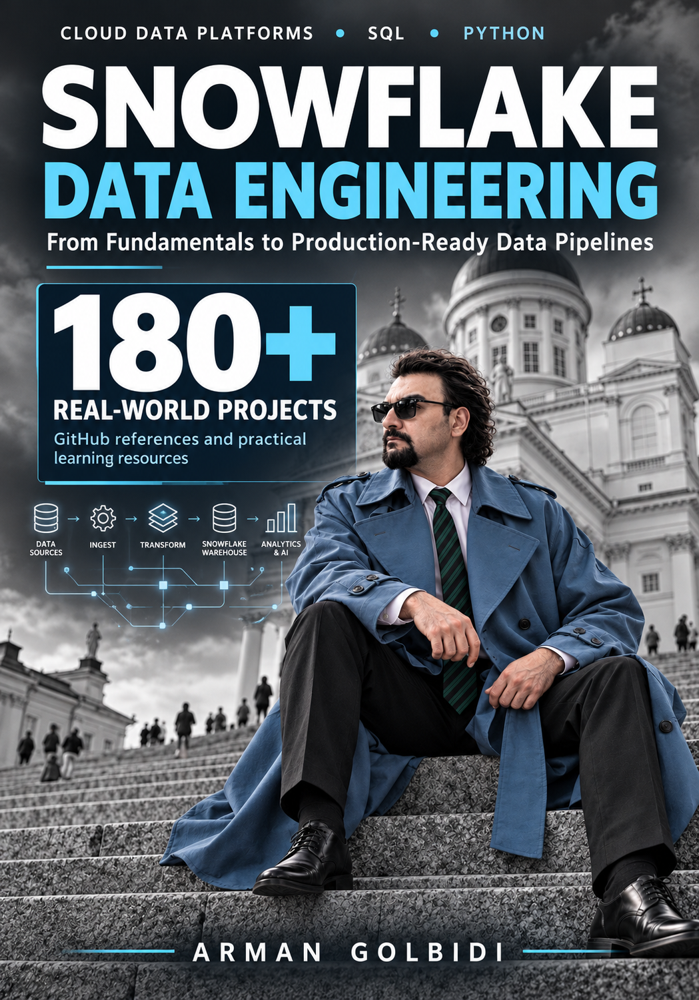
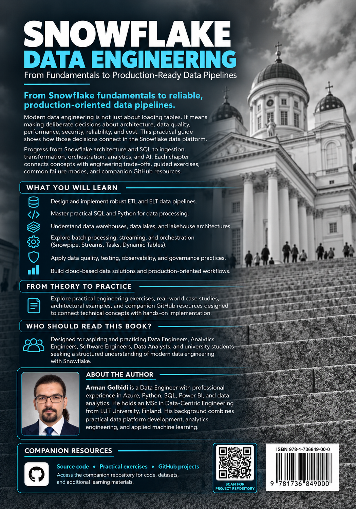

# Snowflake Data Engineering

### From Fundamentals to Production-Ready Data Pipelines

**Arman Golbidi** · English-language technical book · Snowflake, SQL, Python, dbt, Power BI and data-platform engineering

<p align="center">
  <a href="Images/1.FrontCover.png"></a>
  &nbsp;&nbsp;
  <a href="Images/2.BackCover.png"></a>
</p>

<p align="center"><strong>15 chapters · 280 chapter pages · 282-page compiled PDF including covers · 15 chapter companion labs · 181 indexed external GitHub references</strong></p>

> **Read the book:** [Open the complete PDF](Snowflake_Data_Engineering_Arman%20Golbidi.pdf) · **Build:** [Print-master LaTeX source](Snowflake_Data_Engineering_PRINT_MASTER.tex) · **Covers:** [Front](Images/1.FrontCover.png) · [Back](Images/2.BackCover.png)

## About the book

Modern data engineering is not only about moving records into a warehouse. Reliable data platforms also need explicit data contracts, safe ingestion and recovery, reproducible transformations, measurable performance, controlled access, interpretable analytics and operational ownership.

*Snowflake Data Engineering: From Fundamentals to Production-Ready Data Pipelines* follows those engineering decisions from an initial cloud data architecture to a worked **Finland Energy Analytics** capstone. It combines conceptual reasoning, SQL/Python examples, design trade-offs, failure scenarios, exercises, and accompanying educational code. The final chapter connects the major practices into a cohesive end-to-end system design.

This repository preserves the **chapter manuscripts in editable LaTeX**, **individual chapter PDFs**, **synthetic datasets**, **offline verification scripts**, **illustrative Snowflake SQL**, **Power BI/dbt reference files**, and selected editorial/cover assets included in the distributed archive.

### What you will learn

- Explain Snowflake's architecture, compute/storage separation and major engineering trade-offs.
- Ingest, validate and model structured, semi-structured, batch and near-real-time data.
- Build change-aware transformations with Streams, Tasks, Dynamic Tables, Snowpark and dbt.
- Define trusted analytical metrics and plan Power BI semantic models and dashboards.
- Diagnose performance bottlenecks and record reproducible cost/latency evidence.
- Design for least privilege, data governance, incident response and controlled spending.
- Evaluate educational AI/ML use cases, limitations and quality checks without misrepresenting simulated results.
- Connect these practices in a documented energy analytics capstone.

### Intended readership

Aspiring and practising data engineers, analytics engineers, BI professionals, SQL/Python developers, solution architects and advanced students. Familiarity with SQL and basic Python helps for the intermediate and advanced labs. Some optional activities require a separate, authorised Snowflake sandbox or Power BI Desktop installation.

## Start here

1. [Read the full book (PDF)](Snowflake_Data_Engineering_Arman%20Golbidi.pdf).
2. Use the [chapter directory](#complete-chapter-directory) to open a chapter's PDF, source and companion lab.
3. Follow the [offline lab quick start](#offline-labs-and-reproducibility) before considering any cloud-based steps.
4. Consult the [complete list of 181 external GitHub projects](#all-181-external-github-project-references) for additional learning resources, *not* as verified code dependencies.
5. See [Building the complete PDF](#building-the-complete-pdf) to reproduce the 282-page print-layout document.

## Complete chapter directory

The pagination below refers to **printed manuscript page numbers**, not physical pages in the cover-inclusive PDF. The book's 15 chapters span manuscript pages **009–288**.

| Chapter | Title | Book pages | Manuscript and lab |
|:--:|---|:--:|---|
| 01 | Introduction to Snowflake and Modern Data Engineering | 009–020 | [PDF](chapter_1/Snowflake_Data_Engineering_Chapter_01.pdf) · [LaTeX](chapter_1/Snowflake_Data_Engineering_01.tex) · [Lab](chapter_1/Snowflake_Chapter01_Lab) |
| 02 | Snowflake Architecture: Storage, Compute, and Services | 021–038 | [PDF](chapter_2/Snowflake_Data_Engineering_Chapter_02.pdf) · [LaTeX](chapter_2/Snowflake_Data_Engineering_Chapter_02.tex) · [Lab](chapter_2/Chapter_02_Lab) |
| 03 | Setting Up Snowflake and Development Environments | 039–056 | [PDF](chapter_3/Snowflake_Data_Engineering_Chapter_03.pdf) · [LaTeX](chapter_3/Snowflake_Data_Engineering_Chapter_03.tex) · [Lab](chapter_3/snowflake_ch03_build/lab) |
| 04 | Snowflake SQL and Data Modeling | 057–076 | [PDF](chapter_4/Snowflake_Data_Engineering_Chapter_04.pdf) · [LaTeX](chapter_4/Snowflake_Data_Engineering_Chapter_04.tex) · [Lab](chapter_4/lab) |
| 05 | Batch Data Ingestion and Loading | 077–096 | [PDF](Chapter_5/Snowflake_Data_Engineering_Chapter_05.pdf) · [LaTeX](Chapter_5/Snowflake_Data_Engineering_Chapter_05.tex) · [Lab](Chapter_5/lab) |
| 06 | JSON and Semi-Structured Data | 097–112 | [PDF](Chapter_6/Snowflake_Data_Engineering_Chapter_06.pdf) · [LaTeX](Chapter_6/Snowflake_Data_Engineering_Chapter_06.tex) · [Lab](Chapter_6/lab) |
| 07 | Snowpipe, Streaming, and Real-Time Ingestion | 113–132 | [PDF](Chapter_7/Snowflake_Data_Engineering_Chapter_07.pdf) · [LaTeX](Chapter_7/Snowflake_Data_Engineering_Chapter_07.tex) · [Lab](Chapter_7/Chapter07_Lab) |
| 08 | Streams, Tasks, and Dynamic Tables | 133–150 | [PDF](Chapter_8/Snowflake_Data_Engineering_Chapter_08.pdf) · [LaTeX](Chapter_8/Snowflake_Data_Engineering_Chapter_08.tex) · [Lab](Chapter_8/lab) |
| 09 | Data Engineering with Snowpark Python | 151–170 | [PDF](Chapter_9/Snowflake_Data_Engineering_Chapter_09.pdf) · [LaTeX](Chapter_9/Snowflake_Data_Engineering_Chapter_09.tex) · [Lab](Chapter_9/lab) |
| 10 | ETL/ELT Pipelines, dbt, and Delivery Workflows | 171–190 | [PDF](Chapter_10/Snowflake_Data_Engineering_Chapter_10.pdf) · [LaTeX](Chapter_10/Snowflake_Data_Engineering_Chapter_10.tex) · [Lab](Chapter_10/lab) |
| 11 | Analytics Engineering and Power BI Integration | 191–208 | [PDF](Chapter_11/Snowflake_Data_Engineering_Chapter_11.pdf) · [LaTeX](Chapter_11/Snowflake_Data_Engineering_Chapter_11.tex) · [Lab](Chapter_11/lab) |
| 12 | Query Performance and Warehouse Optimization | 209–226 | [PDF](Chapter_12/Snowflake_Data_Engineering_Chapter_12.pdf) · [LaTeX](Chapter_12/Snowflake_Data_Engineering_Chapter_12.tex) · [Lab](Chapter_12/Chapter_12_Lab) |
| 13 | Security, Governance, Reliability, and Cost | 227–248 | [PDF](Chapter_13/Snowflake_Data_Engineering_Chapter_13.pdf) · [LaTeX](Chapter_13/Snowflake_Data_Engineering_Chapter_13.tex) · [Lab](Chapter_13/lab) |
| 14 | Snowflake Cortex AI and Machine Learning | 249–264 | [PDF](Chapter_14/Snowflake_Data_Engineering_Chapter_14.pdf) · [LaTeX](Chapter_14/Snowflake_Data_Engineering_Chapter_14.tex) · [Lab](Chapter_14/lab) |
| 15 | Capstone: A Production-Ready Energy Data Platform | 265–288 | [PDF](Chapter_15/Snowflake_Data_Engineering_Chapter_15.pdf) · [LaTeX](Chapter_15/Snowflake_Data_Engineering_Chapter_15.tex) · [Lab](Chapter_15/lab) |

## Project directory: 15 bundled companion labs

These are the **locally included educational projects**. Each has its own setup notes, inputs and limitations. Their example datasets are synthetic; numerical outputs from different chapters may intentionally represent different independent exercises.

| Lab | Scope and deliverable | Files |
|:--:|---|---|
| 01 | Define the Finland Energy Analytics problem, check source grain and intervals, and practice basic synthetic energy validation. | [Lab files](chapter_1/Snowflake_Chapter01_Lab) · [Instructions](chapter_1/Snowflake_Chapter01_Lab/README.md) |
| 02 | Examine Snowflake storage/compute separation, a query walkthrough, and architecture trade-off evidence. | [Lab files](chapter_2/Chapter_02_Lab) · [Instructions](chapter_2/Chapter_02_Lab/LAB_README.md) |
| 03 | Prepare a governed training environment; study least-privilege setup and safe connection preflight. | [Lab files](chapter_3/snowflake_ch03_build/lab) · [Instructions](chapter_3/snowflake_ch03_build/lab/README.md) |
| 04 | Model energy facts and dimensions, enforce a business grain, and validate revisions using SQL-oriented checks. | [Lab files](chapter_4/lab) · [Instructions](chapter_4/lab/README.md) |
| 05 | Manage immutable batch files, provenance, reconciliation, load history, and error quarantine. | [Lab files](Chapter_5/lab) · [Instructions](Chapter_5/lab/README.md) |
| 06 | Parse JSON envelopes, validate contracts, flatten nested readings, and reject malformed or inconsistent payloads. | [Lab files](Chapter_6/lab) · [Instructions](Chapter_6/lab/README.md) |
| 07 | Simulate stream delivery, retries, deduplication, freshness and offset-based recovery. | [Lab files](Chapter_7/Chapter07_Lab) · [Instructions](Chapter_7/Chapter07_Lab/README.md) |
| 08 | Compare change-aware incremental updates with a declarative current-state model. | [Lab files](Chapter_8/lab) · [Instructions](Chapter_8/lab/README.md) |
| 09 | Implement energy transformations and tests in Python; review optional Snowpark integration. | [Lab files](Chapter_9/lab) · [Instructions](Chapter_9/lab/README.md) |
| 10 | Study a dbt staging/intermediate/mart project, contract tests, and a guarded release workflow. | [Lab files](Chapter_10/lab) · [Instructions](Chapter_10/lab/README.md) |
| 11 | Define trusted KPIs, semantic model relationships, DAX measures, and a Power BI handoff specification. | [Lab files](Chapter_11/lab) · [Instructions](Chapter_11/lab/README.md) |
| 12 | Prepare repeatable query comparisons, benchmark templates, and evidence-based tuning notes. | [Lab files](Chapter_12/Chapter_12_Lab) · [Instructions](Chapter_12/Chapter_12_Lab/LAB_README.md) |
| 13 | Test simulated RBAC decisions, cost registers, incident responses, and safe SQL policy examples. | [Lab files](Chapter_13/lab) · [Instructions](Chapter_13/lab/README.md) |
| 14 | Evaluate offline forecast baselines, anomaly checks, model-card documentation, and optional Cortex examples. | [Lab files](Chapter_14/lab) · [Instructions](Chapter_14/lab/README.md) |
| 15 | Integrate contracts, synthetic events, data quality, Gold marts, CI checks, architecture decisions, and operational runbooks. | [Lab files](Chapter_15/lab) · [Instructions](Chapter_15/lab/README.md) |

### Included tooling by topic

- **SQL:** DDL, data-quality assertions, ingest examples, incremental transformations, view definitions, governance policies and benchmarking templates.
- **Python:** synthetic data fixtures, contract oracles, deterministic local simulators, forecasting baselines and automated `unittest` suites.
- **dbt:** a teaching project with stages, intermediate models, marts, schema tests, custom assertions and example CI workflows (Chapter 10).
- **Power BI:** semantic model documentation, example DAX measures, Power Query connection examples and dashboard planning documents (Chapter 11). **No compiled `.pbix` is included.**
- **Operational artefacts:** architecture decisions, contracts, release checklists, incident runbooks and quality reports.

## Repository layout

```text
.
├── README.md                                # This guide, including all 181 project references
├── Snowflake_Data_Engineering_Arman Golbidi.pdf
├── Snowflake_Data_Engineering_PRINT_MASTER.tex
├── Images/
│   ├── 1.FrontCover.png
│   └── 2.BackCover.png
├── covers/                                  # One-page PDFs used by the print master
│   ├── front.pdf
│   └── back.pdf
├── chapters/                                # Copies used by the print master
│   ├── chapter_01.pdf
│   ├── ...
│   └── chapter_15.pdf
├── chapter_1/ ... chapter_4/               # Original archive casing
├── Chapter_5/ ... Chapter_15/              # Original archive casing
│   ├── Snowflake_Data_Engineering_Chapter_XX.tex
│   ├── Snowflake_Data_Engineering_Chapter_XX.pdf
│   └── <chapter-specific companion project>/
├── BUILD.md                                 # Build and verification instructions
├── RIGHTS_AND_PUBLICATION_NOTES.md          # Reuse and pre-publication notes
└── MANIFEST_SHA256.txt                       # Per-file digest record
```

> **Case sensitivity:** Original paths intentionally use both `chapter_1` and `Chapter_5` styles. GitHub and Linux treat these paths differently. Do not rename directories without updating the links and print-master build.

## Offline labs and reproducibility

The companion labs primarily use **synthetic data and Python's standard library**. You can generally run the offline portions with Python 3.10+ and no Snowflake credentials. For the complete, chapter-specific prerequisites, always read the local lab README or `LAB_README.md` first.

Example, Chapter 15 capstone:

```bash
cd Chapter_15/lab
python project/python/capstone.py
python -m unittest discover -s project/tests -v
```

This validates an educational event/revision contract using synthetic data. The documented capstone fixture resolves 12 deliveries into 6 visible current observations totaling **66.000 MWh**. That result is **not** observed Finnish grid production, a Snowflake cloud result or a deployed production platform.

### Commands by chapter

Execute each group **from the specified directory**. The commands below illustrate the offline route; optional Snowflake/dbt/Power BI integrations need additional setup and are not implied to have passed.

| Ch. | Run from | Offline commands |
|:--:|---|---|
| 01 | `chapter_1/Snowflake_Chapter01_Lab` | `python chapter01_lab.py` |
| 02 | `chapter_2/Chapter_02_Lab` | `python offline_validate.py` |
| 03 | `chapter_3/snowflake_ch03_build/lab` | `python lab_preflight.py` |
| 04 | `chapter_4/lab` | `python validate_fixture.py; python -m unittest discover -s tests -v` |
| 05 | `Chapter_5/lab` | `python validate_fixture.py; python -m unittest discover -s tests -v` |
| 06 | `Chapter_6/lab` | `python validate_payloads.py; python -m unittest discover -s tests -v` |
| 07 | `Chapter_7/Chapter07_Lab` | `python streaming_simulator.py --out output; python -m unittest -v test_streaming_simulator.py` |
| 08 | `Chapter_8/lab` | `python incremental_model.py; python -m unittest -v test_incremental_model.py` |
| 09 | `Chapter_9/lab` | `python snowpark_pipeline.py; python -m unittest -v test_snowpark.py` |
| 10 | `Chapter_10/lab` | `python offline_oracle.py; python -m unittest -v test_pipeline.py` |
| 11 | `Chapter_11/lab` | `python metrics.py; python -m unittest discover -s tests -v` |
| 12 | `Chapter_12/Chapter_12_Lab` | `python offline_validate.py; python -m unittest -v test_lab.py` |
| 13 | `Chapter_13/lab` | `python security_lab.py; python -m unittest discover -s tests -v` |
| 14 | `Chapter_14/lab` | `python ml_baseline.py; python -m unittest discover -s tests -v` |
| 15 | `Chapter_15/lab` | `python project/python/capstone.py; python -m unittest discover -s project/tests -v` |

### Evidence standards

- A passing Python test establishes only the behaviour of that **local fixture and implementation**.
- Cloud-facing SQL, Snowpark, dbt, Power BI and Cortex examples should be **reviewed in a disposable, least-privilege training environment** before use.
- Do not mistake synthetic timings, token budgets, credit estimates or MWh totals for real measurements.
- Consult the per-chapter quality reports for the recorded scope, known limitations, assumptions and evidence of local checks.
- Never commit account tokens, private keys, real customer data, `.env` files or generated credential profiles. The included `.env.example` is a template, not a configured connection.

## Building the complete PDF

A complete, **282-page** PDF is already provided above. The original `Snowflake_Data_Engineering_PRINT_MASTER.tex` expects `covers/` and `chapters/`. Those directories are included in this GitHub-ready edition so its relative paths resolve without manual reconstruction.

With a TeX distribution containing the `geometry`, `pdfpages` and `hyperref` packages:

```bash
xelatex -interaction=nonstopmode -halt-on-error Snowflake_Data_Engineering_PRINT_MASTER.tex
xelatex -interaction=nonstopmode -halt-on-error Snowflake_Data_Engineering_PRINT_MASTER.tex
```

This generates `Snowflake_Data_Engineering_PRINT_MASTER.pdf`. The print master **embeds pre-typeset chapter PDFs** and preserves their existing page design. For editing a chapter, modify the source `.tex` under that chapter, compile its corresponding chapter PDF, and then update the matching `chapters/chapter_XX.pdf` before rebuilding the full book. See [BUILD.md](BUILD.md).

**Trim size:** 178 × 254 mm. The chapter layout was prepared using English body text in the 10.5–11 pt range, code in the 8.5–9 pt range, inner margin 22–25 mm, outer margin 16–18 mm, and top/bottom margins 18–22 mm. The target page ranges are a manuscript plan; covers add two further physical pages. The planned 8 pages of front matter and 12 appendix/index pages are **not included** as independently typeset manuscript material in this archive.

## Local verification status (22 October 2026)

In the packaging review, the default **offline command path for every chapter (15/15)** exited successfully. The root XeLaTeX print master also compiled successfully into a **282-page PDF**, and extracted text matched the source compiled book on every page. These checks validate local packaging and teaching fixtures only; they do **not** establish that all live Snowflake, Cortex, dbt or Power BI integrations work.

For detailed checks and limitations, see [REPOSITORY_QA_REPORT.md](REPOSITORY_QA_REPORT.md).

## Publishing this repository on GitHub

**Extract the ZIP first.** Upload its extracted **files and folders** as your Git repository root, rather than uploading the ZIP alone. GitHub will render `README.md` on the repository homepage and load the two cover images through relative links.

You can publish using Git after creating an empty repository on GitHub:

```bash
cd Arman_Golbidi_GitHub_Ready
git init
git add .
git commit -m "Publish Snowflake Data Engineering book and companion labs"
git branch -M main
git remote add origin https://github.com/YOUR-USERNAME/YOUR-REPOSITORY.git
git push -u origin main
```

Replace `YOUR-USERNAME` and `YOUR-REPOSITORY` with your own values. Run `git status` and review all staged files before pushing, especially **personal photographs, editorial drafts and any potentially sensitive material**. The provided `.gitignore` excludes transient Python/LaTeX build files and common secret-file patterns. GitHub repository content becomes publicly visible if you choose a *public* repository. An official book ISBN/license is **not** created by uploading files.

## Project reference policy

The following catalogue contains **181 distinct third-party or Snowflake-related GitHub repositories** referenced in the book's original research directory. These are **external learning references**—not 181 pieces of software copied into this repository, and not 181 verified hands-on deployments.

The numbered identifiers `P001`–`P181`, repository owners and primary placements below are reproduced from the project's source directory. A repo may be used as inspiration in other chapter sections too. Repository links and content may have changed since the source directory's **21 October 2026** research checkpoint. **Existence, compatibility, run status, licensing, costs and permissions must be rechecked independently before reproducing or deploying anything.**

## All 181 external GitHub project references

Use the expandable chapter categories to browse **every indexed project**, with its canonical repository link, primary teaching section and any additional section placements.

<details>
<summary><strong>Chapter 01 — Introduction to Snowflake and Modern Data Engineering (11 references)</strong></summary>

- **P001** — [Snowflake-Labs/modern-data-engineering-snowflake](https://github.com/Snowflake-Labs/modern-data-engineering-snowflake) · §1.1
- **P002** — [Snowflake-Labs/sfguide-getting-started-with-iceberg-tables](https://github.com/Snowflake-Labs/sfguide-getting-started-with-iceberg-tables) · §1.2 · also §2.9, § 6.7
- **P003** — [Snowflake-Labs/sfguide-getting-started-with-hybrid-tables-performance-testing](https://github.com/Snowflake-Labs/sfguide-getting-started-with-hybrid-tables-performance-testing) · §1.3 · also §4.5, § 12.4
- **P004** — [Snowflake-Labs/sfguide-getting-started-from-zero-to-snowflake](https://github.com/Snowflake-Labs/sfguide-getting-started-from-zero-to-snowflake) · §1.4 · also §3.1
- **P005** — [Snowflake-Labs/sfguide-data-apps-demo](https://github.com/Snowflake-Labs/sfguide-data-apps-demo) · §1.4
- **P006** — [Snowflake-Labs/sfguide-snowflake-northstar-data-engineering](https://github.com/Snowflake-Labs/sfguide-snowflake-northstar-data-engineering) · §1.5 · also §5.4, § 15.1
- **P007** — [Snowflake-Labs/sfguide-getting-started-with-time-series-using-snowflake-streaming-sis-ml-notebooks](https://github.com/Snowflake-Labs/sfguide-getting-started-with-time-series-using-snowflake-streaming-sis-ml-notebooks) · §1.6 · also §7.1
- **P008** — [Snowflake-Labs/sfguide-recommender-pipeline](https://github.com/Snowflake-Labs/sfguide-recommender-pipeline) · §1.6
- **P009** — [Snowflake-Labs/advanced-data-engineering-snowflake](https://github.com/Snowflake-Labs/advanced-data-engineering-snowflake) · §1.7
- **P010** — [Snowflake-Labs/sfguide-ai-powered-predictive-grid-maintenance](https://github.com/Snowflake-Labs/sfguide-ai-powered-predictive-grid-maintenance) · §1.8 · also §14.6
- **P011** — [nbaubek/green-energy-iot-de-project](https://github.com/nbaubek/green-energy-iot-de-project) · §1.8 · also §15.2

</details>

<details>
<summary><strong>Chapter 02 — Snowflake Architecture: Storage, Compute, and Services (11 references)</strong></summary>

- **P012** — [Snowflake-Labs/sfguide-data-engineering-with-notebooks](https://github.com/Snowflake-Labs/sfguide-data-engineering-with-notebooks) · §2.1
- **P013** — [Snowflake-Labs/sfguide-getting-started-with-pandas-on-snowflake](https://github.com/Snowflake-Labs/sfguide-getting-started-with-pandas-on-snowflake) · §2.2 · also §9.8, § 12.5
- **P014** — [snowflakedb/snowflake-cli](https://github.com/snowflakedb/snowflake-cli) · §2.3
- **P015** — [Snowflake-Labs/sfguide-snowflake-python-api](https://github.com/Snowflake-Labs/sfguide-snowflake-python-api) · §2.4 · also §9.6
- **P016** — [Snowflake-Labs/sfguide-getting-started-snowflake-python-api](https://github.com/Snowflake-Labs/sfguide-getting-started-snowflake-python-api) · §2.4 · also §3.3, § 3.5
- **P017** — [sfc-gh-bokon/query_performance_deep_dive](https://github.com/sfc-gh-bokon/query_performance_deep_dive) · §2.5 · also §12.1
- **P018** — [Snowflake-Labs/sfguide-snowpark-python-top-three-tips-for-optimal-performance](https://github.com/Snowflake-Labs/sfguide-snowpark-python-top-three-tips-for-optimal-performance) · §2.6 · also §9.8, § 12.2, § 12.6
- **P019** — [edx/snowflake_timetravel_table](https://github.com/edx/snowflake_timetravel_table) · §2.7
- **P020** — [Snowflake-Labs/sfguide-getting-started-with-snowflake-managed-mcp-and-bedrock-agentcore](https://github.com/Snowflake-Labs/sfguide-getting-started-with-snowflake-managed-mcp-and-bedrock-agentcore) · §2.8
- **P021** — [Snowflake-Labs/sfguide-getting-started-with-openflow-spcs](https://github.com/Snowflake-Labs/sfguide-getting-started-with-openflow-spcs) · §2.8 · also §7.8
- **P022** — [Snowflake-Labs/sfguide-build-data-application-with-hybrid-tables](https://github.com/Snowflake-Labs/sfguide-build-data-application-with-hybrid-tables) · §2.9

</details>

<details>
<summary><strong>Chapter 03 — Setting Up Snowflake and Development Environments (12 references)</strong></summary>

- **P023** — [Snowflake-Labs/sfguide-getting-started-with-snowpark-in-worksheets-notebooks](https://github.com/Snowflake-Labs/sfguide-getting-started-with-snowpark-in-worksheets-notebooks) · §3.2
- **P024** — [Infostrux-Solutions/terraform-snowflake-rbac-infra](https://github.com/Infostrux-Solutions/terraform-snowflake-rbac-infra) · §3.4 · also §13.2
- **P025** — [snowflakedb/snowflake-cli-templates](https://github.com/snowflakedb/snowflake-cli-templates) · §3.5
- **P026** — [snowflakedb/snowflake-cli-action](https://github.com/snowflakedb/snowflake-cli-action) · §3.5 · also §10.7
- **P027** — [snowflakedb/snowflake-connector-python](https://github.com/snowflakedb/snowflake-connector-python) · §3.6
- **P028** — [Snowflake-Labs/sfguide-getting-started-with-snowflake-devops](https://github.com/Snowflake-Labs/sfguide-getting-started-with-snowflake-devops) · §3.7 · also §10.7, § 15.11
- **P029** — [sfc-gh-sekim/cicd-snowflake-with-terraform-demo](https://github.com/sfc-gh-sekim/cicd-snowflake-with-terraform-demo) · §3.7
- **P030** — [streamlit/snowflake-usage-app](https://github.com/streamlit/snowflake-usage-app) · §3.8 · also §11.7, § 13.8
- **P031** — [get-select/dbt-snowflake-monitoring](https://github.com/get-select/dbt-snowflake-monitoring) · §3.8 · also §13.7
- **P032** — [Snowflake-Labs/sfguide-terraform-sample](https://github.com/Snowflake-Labs/sfguide-terraform-sample) · §3.9
- **P033** — [snowflakedb/terraform-provider-snowflake](https://github.com/snowflakedb/terraform-provider-snowflake) · §3.9
- **P034** — [Hiflylabs/snowflake-terraform-boostrap](https://github.com/Hiflylabs/snowflake-terraform-boostrap) · §3.9 · also §10.9

</details>

<details>
<summary><strong>Chapter 04 — Snowflake SQL and Data Modeling (11 references)</strong></summary>

- **P035** — [Snowflake-Labs/sfguide-getting-started-with-data-analytics-with-sql-python](https://github.com/Snowflake-Labs/sfguide-getting-started-with-data-analytics-with-sql-python) · §4.1
- **P036** — [clausherther/dbt-tpch](https://github.com/clausherther/dbt-tpch) · §4.2
- **P037** — [Snowflake-Labs/sfguide-data-engineering-pipelines-with-pandas-on-snowflake](https://github.com/Snowflake-Labs/sfguide-data-engineering-pipelines-with-pandas-on-snowflake) · §4.3 · also §5.8
- **P038** — [Snowflake-Labs/sfguide-getting-started-with-time-series-analytics-with-pricing-data-on-snowflake](https://github.com/Snowflake-Labs/sfguide-getting-started-with-time-series-analytics-with-pricing-data-on-snowflake) · §4.4
- **P039** — [Jb-Analytics/snowflake-dbt-tpch-medallion](https://github.com/Jb-Analytics/snowflake-dbt-tpch-medallion) · §4.6 · also §15.6
- **P040** — [Data-Engineer-Camp/modern-elt-demo](https://github.com/Data-Engineer-Camp/modern-elt-demo) · §4.6
- **P041** — [osmacero/snowflake-healthcare-data-engineering](https://github.com/osmacero/snowflake-healthcare-data-engineering) · §4.7
- **P042** — [ScalefreeCOM/datavault4dbt-snowflake-demo](https://github.com/ScalefreeCOM/datavault4dbt-snowflake-demo) · §4.7 · also §10.5
- **P043** — [Snowflake-Labs/sfguide-building-retail-analytics-de-pipeline](https://github.com/Snowflake-Labs/sfguide-building-retail-analytics-de-pipeline) · §4.8 · also §5.7, § 10.2
- **P044** — [Montreal-Analytics/dbt-snowflake-utils](https://github.com/Montreal-Analytics/dbt-snowflake-utils) · §4.9
- **P045** — [Snowflake-Labs/dbt_constraints](https://github.com/Snowflake-Labs/dbt_constraints) · §4.9 · also §10.4

</details>

<details>
<summary><strong>Chapter 05 — Batch Data Ingestion and Loading (12 references)</strong></summary>

- **P046** — [Snowflake-Labs/sfguide-getting-started-with-snowflake-connector-for-google-analytics](https://github.com/Snowflake-Labs/sfguide-getting-started-with-snowflake-connector-for-google-analytics) · §5.1
- **P047** — [Snowflake-Labs/sfguide-getting-started-with-api-enrichment-framework](https://github.com/Snowflake-Labs/sfguide-getting-started-with-api-enrichment-framework) · §5.1 · also §5.6
- **P048** — [Snowflake-Labs/sfguide-twitter-auto-ingest](https://github.com/Snowflake-Labs/sfguide-twitter-auto-ingest) · §5.2 · also §7.2
- **P049** — [subhamay-bhattacharyya-tf/terraform-snowflake-file-format](https://github.com/subhamay-bhattacharyya-tf/terraform-snowflake-file-format) · §5.2
- **P050** — [Snowflake-Labs/terraform-snowflake-storage-integration-aws](https://github.com/Snowflake-Labs/terraform-snowflake-storage-integration-aws) · §5.3
- **P051** — [Infostrux-Solutions/terraform-snowflake-snowpipe](https://github.com/Infostrux-Solutions/terraform-snowflake-snowpipe) · §5.3
- **P052** — [AvinashAnalytics/End-to-End-Snowflake-Data-Pipeline](https://github.com/AvinashAnalytics/End-to-End-Snowflake-Data-Pipeline) · §5.4
- **P053** — [Snowflake-Labs/sfguide-data-engineering-with-coco](https://github.com/Snowflake-Labs/sfguide-data-engineering-with-coco) · §5.5
- **P054** — [camposvinicius/aws-snowflake-etl](https://github.com/camposvinicius/aws-snowflake-etl) · §5.8
- **P055** — [Snowflake-Labs/sfguide-alert-hub](https://github.com/Snowflake-Labs/sfguide-alert-hub) · §5.9 · also §8.8, § 13.9, § 15.10
- **P056** — [Snowflake-Labs/terraform-snowflake-snowpipe-aws](https://github.com/Snowflake-Labs/terraform-snowflake-snowpipe-aws) · §5.9 · also §7.3
- **P057** — [sfc-gh-kmotokubota/streamlit-data-loader-explorer](https://github.com/sfc-gh-kmotokubota/streamlit-data-loader-explorer) · §5.9

</details>

<details>
<summary><strong>Chapter 06 — JSON and Semi-Structured Data (10 references)</strong></summary>

- **P058** — [Snowflake-Labs/sfguide-getting-started-with-document-ai](https://github.com/Snowflake-Labs/sfguide-getting-started-with-document-ai) · §6.1
- **P059** — [Snowflake-Labs/sfguide-gaining-insights-from-unstructured-data-with-cortex-ai](https://github.com/Snowflake-Labs/sfguide-gaining-insights-from-unstructured-data-with-cortex-ai) · §6.2
- **P060** — [kromozome2003/Snowflake-Json-DataPipeline](https://github.com/kromozome2003/Snowflake-Json-DataPipeline) · §6.3
- **P061** — [atharvadevne123/Automated-json-pipeline-snowflake-streams-tasks](https://github.com/atharvadevne123/Automated-json-pipeline-snowflake-streams-tasks) · §6.3
- **P062** — [Snowflake-Labs/sfguide-extracting-insights-from-multimodal-customer-data](https://github.com/Snowflake-Labs/sfguide-extracting-insights-from-multimodal-customer-data) · §6.4
- **P063** — [Snowflake-Labs/sfguide-extracting-insights-from-video-with-multimodal-ai-analysis](https://github.com/Snowflake-Labs/sfguide-extracting-insights-from-video-with-multimodal-ai-analysis) · §6.5
- **P064** — [Snowflake-Labs/sfguide-monitor-schema-drift-in-data-shares-with-sharewatch](https://github.com/Snowflake-Labs/sfguide-monitor-schema-drift-in-data-shares-with-sharewatch) · §6.6 · also §13.5
- **P065** — [Snowflake-Labs/sfguide-data-crawler](https://github.com/Snowflake-Labs/sfguide-data-crawler) · §6.7
- **P066** — [Snowflake-Labs/sfguide-document-ai-invoice-reconciliation](https://github.com/Snowflake-Labs/sfguide-document-ai-invoice-reconciliation) · §6.8
- **P067** — [Snowflake-Labs/sfguide-document-ai-pipeline-automation-in-snowflake](https://github.com/Snowflake-Labs/sfguide-document-ai-pipeline-automation-in-snowflake) · §6.8

</details>

<details>
<summary><strong>Chapter 07 — Snowpipe, Streaming, and Real-Time Ingestion (13 references)</strong></summary>

- **P068** — [snowflakedb/snowpipe-streaming-sdk-examples](https://github.com/snowflakedb/snowpipe-streaming-sdk-examples) · §7.4
- **P069** — [Snowflake-Labs/sfguide-getting-started-with-snowpipe-streaming-apache-iceberg-snowflake-open-catalog](https://github.com/Snowflake-Labs/sfguide-getting-started-with-snowpipe-streaming-apache-iceberg-snowflake-open-catalog) · §7.4
- **P070** — [snowflakedb/snowflake-kafka-connector](https://github.com/snowflakedb/snowflake-kafka-connector) · §7.4
- **P071** — [snowflakedb/snowflake-ingest-python](https://github.com/snowflakedb/snowflake-ingest-python) · §7.5
- **P072** — [snowflakedb/snowflake-ingest-java](https://github.com/snowflakedb/snowflake-ingest-java) · §7.5
- **P073** — [Snowflake-Labs/sfguide-kafka-interactive-tables-streaming](https://github.com/Snowflake-Labs/sfguide-kafka-interactive-tables-streaming) · §7.6 · also §15.4
- **P074** — [machkuma/aws-dms-s3-snowflake-cdc-snowpipe](https://github.com/machkuma/aws-dms-s3-snowflake-cdc-snowpipe) · §7.6
- **P075** — [Snowflake-Labs/simstreamer](https://github.com/Snowflake-Labs/simstreamer) · §7.7
- **P076** — [Murataydinunimi/Real_Time_Streaming_Kafka_Airflow_DBT_Snowflake_ELK-Stack](https://github.com/Murataydinunimi/Real_Time_Streaming_Kafka_Airflow_DBT_Snowflake_ELK-Stack) · §7.7
- **P077** — [Snowflake-Labs/openflow-structured-data-pipeline-demo](https://github.com/Snowflake-Labs/openflow-structured-data-pipeline-demo) · §7.8
- **P078** — [Snowflake-Labs/sfguide-getting-started-openflow-postgresql-cdc](https://github.com/Snowflake-Labs/sfguide-getting-started-openflow-postgresql-cdc) · §7.8
- **P079** — [Snowflake-Labs/Summit2025-DE214](https://github.com/Snowflake-Labs/Summit2025-DE214) · §7.9
- **P080** — [JeetThakore/Real-Time-Heart-Rate-ELT-Pipeline-Kafka-Streaming-to-Snowflake-with-Airbyte-dbt-Dagster-Tableau](https://github.com/JeetThakore/Real-Time-Heart-Rate-ELT-Pipeline-Kafka-Streaming-to-Snowflake-with-Airbyte-dbt-Dagster-Tableau) · §7.9

</details>

<details>
<summary><strong>Chapter 08 — Streams, Tasks, and Dynamic Tables (13 references)</strong></summary>

- **P081** — [Snowflake-Labs/sfguide-intro-to-cdc-using-snowflake-postgres-connector-dynamic-tables](https://github.com/Snowflake-Labs/sfguide-intro-to-cdc-using-snowflake-postgres-connector-dynamic-tables) · §8.1
- **P082** — [kovinaveenkumar/snowflake-incremental-dw](https://github.com/kovinaveenkumar/snowflake-incremental-dw) · §8.1
- **P083** — [Snowflake-Labs/sproc-to-create-streams](https://github.com/Snowflake-Labs/sproc-to-create-streams) · §8.2
- **P084** — [Snowflake-Labs/sfguide-getting-started-with-task-graphs](https://github.com/Snowflake-Labs/sfguide-getting-started-with-task-graphs) · §8.3
- **P085** — [subhamay-bhattacharyya/snowflake-streams-tasks-etl](https://github.com/subhamay-bhattacharyya/snowflake-streams-tasks-etl) · §8.4
- **P086** — [Alan-Webb-1/snowflake-scd1-pipeline](https://github.com/Alan-Webb-1/snowflake-scd1-pipeline) · §8.4
- **P087** — [Snowflake-Labs/sfguide-declarative-pipelines-dynamic-tables](https://github.com/Snowflake-Labs/sfguide-declarative-pipelines-dynamic-tables) · §8.5
- **P088** — [Snowflake-Labs/sfguide-build-autonomous-pipelines-for-ai-agents](https://github.com/Snowflake-Labs/sfguide-build-autonomous-pipelines-for-ai-agents) · §8.5
- **P089** — [Snowflake-Labs/getting-started-with-dynamic-tables](https://github.com/Snowflake-Labs/getting-started-with-dynamic-tables) · §8.6
- **P090** — [Snowflake-Labs/sfguide-deploying-pipelines-with-snowflake-and-dbt-labs](https://github.com/Snowflake-Labs/sfguide-deploying-pipelines-with-snowflake-and-dbt-labs) · §8.7
- **P091** — [Snowflake-Labs/emerging-solutions-toolbox](https://github.com/Snowflake-Labs/emerging-solutions-toolbox) · §8.8 · also §10.8
- **P092** — [subhamay-bhattacharyya/snowflake-dynamic-table-pipeline](https://github.com/subhamay-bhattacharyya/snowflake-dynamic-table-pipeline) · §8.9
- **P093** — [AidanHarveyNelson/dbt-streams-tasks](https://github.com/AidanHarveyNelson/dbt-streams-tasks) · §8.9

</details>

<details>
<summary><strong>Chapter 09 — Data Engineering with Snowpark Python (14 references)</strong></summary>

- **P094** — [Snowflake-Labs/sfguide-getting-started-snowpark-python](https://github.com/Snowflake-Labs/sfguide-getting-started-snowpark-python) · §9.1
- **P095** — [Snowflake-Labs/snowpark-python-template](https://github.com/Snowflake-Labs/snowpark-python-template) · §9.2
- **P096** — [snowflakedb/snowflake-sqlalchemy](https://github.com/snowflakedb/snowflake-sqlalchemy) · §9.2
- **P097** — [Snowflake-Labs/sfguide-data-engineering-with-snowpark-python-intro](https://github.com/Snowflake-Labs/sfguide-data-engineering-with-snowpark-python-intro) · §9.3
- **P098** — [snowflakedb/snowpark-python](https://github.com/snowflakedb/snowpark-python) · §9.3
- **P099** — [dbt-labs/python-snowpark-formula1](https://github.com/dbt-labs/python-snowpark-formula1) · §9.3
- **P100** — [Snowflake-Labs/snowpark-python-demos](https://github.com/Snowflake-Labs/snowpark-python-demos) · §9.4
- **P101** — [Snowflake-Labs/sfguide-UDF-UDTF-examples](https://github.com/Snowflake-Labs/sfguide-UDF-UDTF-examples) · §9.5
- **P102** — [Snowflake-Labs/sfguide-external-functions-examples](https://github.com/Snowflake-Labs/sfguide-external-functions-examples) · §9.5
- **P103** — [Snowflake-Labs/sfguide_snowpark_on_jupyter](https://github.com/Snowflake-Labs/sfguide_snowpark_on_jupyter) · §9.6
- **P104** — [Snowflake-Labs/sftutorial-snowpark-testing](https://github.com/Snowflake-Labs/sftutorial-snowpark-testing) · §9.7
- **P105** — [Snowflake-Labs/snowpark-devops](https://github.com/Snowflake-Labs/snowpark-devops) · §9.9
- **P106** — [Snowflake-Labs/sfguide-data-engineering-with-snowpark-python](https://github.com/Snowflake-Labs/sfguide-data-engineering-with-snowpark-python) · §9.9
- **P107** — [Snowflake-Labs/sfguide-getting-started-dataengineering-ml-snowpark-python](https://github.com/Snowflake-Labs/sfguide-getting-started-dataengineering-ml-snowpark-python) · §9.9

</details>

<details>
<summary><strong>Chapter 10 — ETL/ELT Pipelines, dbt, and Delivery Workflows (13 references)</strong></summary>

- **P108** — [astronomer/etl-elt-airflow-snowflake](https://github.com/astronomer/etl-elt-airflow-snowflake) · §10.1 · also §15.7
- **P109** — [Snowflake-Labs/getting-started-with-dbt-on-snowflake](https://github.com/Snowflake-Labs/getting-started-with-dbt-on-snowflake) · §10.3
- **P110** — [dbt-labs/snowflake_dbt_partner_demo](https://github.com/dbt-labs/snowflake_dbt_partner_demo) · §10.3
- **P111** — [dbt-labs/snowflake_sko_hol_2026](https://github.com/dbt-labs/snowflake_sko_hol_2026) · §10.3
- **P112** — [dbt-labs/dbt-core](https://github.com/dbt-labs/dbt-core) · §10.4
- **P113** — [arnoN7/dbt-incremental-stream](https://github.com/arnoN7/dbt-incremental-stream) · §10.5
- **P114** — [astronomer/airflow-covid-data](https://github.com/astronomer/airflow-covid-data) · §10.6
- **P115** — [anna-geller/prefect-dataplatform](https://github.com/anna-geller/prefect-dataplatform) · §10.6
- **P116** — [astronautyates/AirflowSnowflakeDBTQuickstart](https://github.com/astronautyates/AirflowSnowflakeDBTQuickstart) · §10.6
- **P117** — [Snowflake-Labs/data-eng-bench](https://github.com/Snowflake-Labs/data-eng-bench) · §10.8 · also §12.8
- **P118** — [Divergent-Insights/dbt-dataquality](https://github.com/Divergent-Insights/dbt-dataquality) · §10.8
- **P119** — [Snowflake-Labs/schemachange](https://github.com/Snowflake-Labs/schemachange) · §10.9
- **P120** — [Snowflake-Labs/sfguide-getting-started-with-devops-data-projects-in-snowflake](https://github.com/Snowflake-Labs/sfguide-getting-started-with-devops-data-projects-in-snowflake) · §10.9 · also §15.3

</details>

<details>
<summary><strong>Chapter 11 — Analytics Engineering and Power BI Integration (14 references)</strong></summary>

- **P121** — [Snowflake-Labs/sfguide-end-to-end-analytics-with-snowflake-and-power-bi](https://github.com/Snowflake-Labs/sfguide-end-to-end-analytics-with-snowflake-and-power-bi) · §11.1 · also §15.8
- **P122** — [Snowflake-Labs/dbt_semantic_view](https://github.com/Snowflake-Labs/dbt_semantic_view) · §11.2
- **P123** — [Snowflake-Labs/semantic-model-generator](https://github.com/Snowflake-Labs/semantic-model-generator) · §11.2
- **P124** — [snowflakedb/snowflake-connector-net](https://github.com/snowflakedb/snowflake-connector-net) · §11.3
- **P125** — [Snowflake-Labs/sfguide-marketplace-data-app](https://github.com/Snowflake-Labs/sfguide-marketplace-data-app) · §11.3
- **P126** — [mattfeks/Snowflake-PowerBI](https://github.com/mattfeks/Snowflake-PowerBI) · §11.4
- **P127** — [Jalpa-08/SNOWFLAKE_POWERBI](https://github.com/Jalpa-08/SNOWFLAKE_POWERBI) · §11.4
- **P128** — [alexfrancisross/snowflake-semantic-views-powerbi](https://github.com/alexfrancisross/snowflake-semantic-views-powerbi) · §11.5
- **P129** — [BalajiKottana/Customer_Insights_with_Snowflake_and_PowerBI](https://github.com/BalajiKottana/Customer_Insights_with_Snowflake_and_PowerBI) · §11.6
- **P130** — [Snowflake-Labs/sfguide-using-snowflake-cortex-and-streamlit-with-geospatial-data](https://github.com/Snowflake-Labs/sfguide-using-snowflake-cortex-and-streamlit-with-geospatial-data) · §11.6
- **P131** — [saundarypareek-analytics/shopify-snowflake-powerbi](https://github.com/saundarypareek-analytics/shopify-snowflake-powerbi) · §11.6
- **P132** — [Snowflake-Labs/streamlit-page-analytics](https://github.com/Snowflake-Labs/streamlit-page-analytics) · §11.7
- **P133** — [Snowflake-Labs/sfguide-horizon-intra-organization-sharing](https://github.com/Snowflake-Labs/sfguide-horizon-intra-organization-sharing) · §11.8 · also §13.5
- **P134** — [Snowflake-Labs/sfguide-intra-company-data-sharing-with-the-snowflake-internal-marketplace](https://github.com/Snowflake-Labs/sfguide-intra-company-data-sharing-with-the-snowflake-internal-marketplace) · §11.8

</details>

<details>
<summary><strong>Chapter 12 — Query Performance and Warehouse Optimization (7 references)</strong></summary>

- **P135** — [deept-agl/Query-Performance-Streamlit-App-in-Snowflake-Notebooks](https://github.com/deept-agl/Query-Performance-Streamlit-App-in-Snowflake-Notebooks) · §12.2
- **P136** — [subhamay-bhattacharyya/snowflake-de-clustering-mv](https://github.com/subhamay-bhattacharyya/snowflake-de-clustering-mv) · §12.3
- **P137** — [subhamay-bhattacharyya/snowflake-de-query-optimization](https://github.com/subhamay-bhattacharyya/snowflake-de-query-optimization) · §12.4
- **P138** — [sfc-gh-hbarile/query_performance_deep_dive](https://github.com/sfc-gh-hbarile/query_performance_deep_dive) · §12.6
- **P139** — [dataengineerankur/SnowflakeCTEAnalyzer](https://github.com/dataengineerankur/SnowflakeCTEAnalyzer) · §12.7
- **P140** — [henbh/dbx-sf-benchmark](https://github.com/henbh/dbx-sf-benchmark) · §12.8
- **P141** — [Bravarthan/snowflake-finops-optimization](https://github.com/Bravarthan/snowflake-finops-optimization) · §12.8

</details>

<details>
<summary><strong>Chapter 13 — Security, Governance, Reliability, and Cost (14 references)</strong></summary>

- **P142** — [Snowflake-Labs/sfguide-getting-started-with-horizon-data-governance-in-snowflake](https://github.com/Snowflake-Labs/sfguide-getting-started-with-horizon-data-governance-in-snowflake) · §13.1
- **P143** — [getindata/terraform-snowflake-role](https://github.com/getindata/terraform-snowflake-role) · §13.2
- **P144** — [Faire/terraforming-snowflake](https://github.com/Faire/terraforming-snowflake) · §13.2
- **P145** — [Snowflake-Labs/sfguide-vault-snowflakepasswords](https://github.com/Snowflake-Labs/sfguide-vault-snowflakepasswords) · §13.3
- **P146** — [sfc-gh-jbellegarde/securing-your-snowflake-account](https://github.com/sfc-gh-jbellegarde/securing-your-snowflake-account) · §13.3
- **P147** — [aballingall/snowflake-security-demo](https://github.com/aballingall/snowflake-security-demo) · §13.4
- **P148** — [sfc-gh-fthomsen/governance-studio](https://github.com/sfc-gh-fthomsen/governance-studio) · §13.4
- **P149** — [Snowflake-Labs/sfguide-native-apps-limited-access-data](https://github.com/Snowflake-Labs/sfguide-native-apps-limited-access-data) · §13.6
- **P150** — [wisemuffin/dbt-snowflake-cost-monitoring](https://github.com/wisemuffin/dbt-snowflake-cost-monitoring) · §13.7
- **P151** — [Matatika/example-snowflake-cost-monitoring](https://github.com/Matatika/example-snowflake-cost-monitoring) · §13.7
- **P152** — [sfc-gh-sochandra/ai-cost-governance](https://github.com/sfc-gh-sochandra/ai-cost-governance) · §13.8 · also §15.9
- **P153** — [Snowflake-Labs/sfguide_failover_scripts](https://github.com/Snowflake-Labs/sfguide_failover_scripts) · §13.9
- **P154** — [snowflakedb/SnowAlert](https://github.com/snowflakedb/SnowAlert) · §13.10
- **P155** — [Snowflake-Labs/sfguide-application-control-framework](https://github.com/Snowflake-Labs/sfguide-application-control-framework) · §13.10

</details>

<details>
<summary><strong>Chapter 14 — Snowflake Cortex AI and Machine Learning (20 references)</strong></summary>

- **P156** — [Snowflake-Labs/sfguide-getting-started-machine-learning](https://github.com/Snowflake-Labs/sfguide-getting-started-machine-learning) · §14.1
- **P157** — [Snowflake-Labs/sfguide-getting-started-with-cortex-ai-functions](https://github.com/Snowflake-Labs/sfguide-getting-started-with-cortex-ai-functions) · §14.2
- **P158** — [Snowflake-Labs/sfguide-getting-started-with-cortex-agents](https://github.com/Snowflake-Labs/sfguide-getting-started-with-cortex-agents) · §14.2
- **P159** — [Snowflake-Labs/sfguide-building-cortex-aisql-powered-callcentre-analytics](https://github.com/Snowflake-Labs/sfguide-building-cortex-aisql-powered-callcentre-analytics) · §14.3
- **P160** — [Snowflake-Labs/sfguide-customer-reviews-analytics-using-snowflake-cortex](https://github.com/Snowflake-Labs/sfguide-customer-reviews-analytics-using-snowflake-cortex) · §14.3
- **P161** — [Snowflake-Labs/sfguide-prompt-engineering-and-llm-evaluation](https://github.com/Snowflake-Labs/sfguide-prompt-engineering-and-llm-evaluation) · §14.3
- **P162** — [Snowflake-Labs/sfguide-ask-questions-to-your-documents-using-rag-with-snowflake-cortex-search](https://github.com/Snowflake-Labs/sfguide-ask-questions-to-your-documents-using-rag-with-snowflake-cortex-search) · §14.4
- **P163** — [Snowflake-Labs/sfguide-getting-started-with-cortex-analyst](https://github.com/Snowflake-Labs/sfguide-getting-started-with-cortex-analyst) · §14.4
- **P164** — [Snowflake-Labs/sfguide-getting-started-with-cortex-analyst-in-snowflake](https://github.com/Snowflake-Labs/sfguide-getting-started-with-cortex-analyst-in-snowflake) · §14.4
- **P165** — [Snowflake-Labs/sfguide-intro-to-machine-learning-with-snowflake-ml-for-python](https://github.com/Snowflake-Labs/sfguide-intro-to-machine-learning-with-snowflake-ml-for-python) · §14.5
- **P166** — [Snowflake-Labs/sfguide-intro-to-feature-store-using-snowflake-notebooks](https://github.com/Snowflake-Labs/sfguide-intro-to-feature-store-using-snowflake-notebooks) · §14.5
- **P167** — [Snowflake-Labs/sfguide-getting-started-with-snowflake-feature-store](https://github.com/Snowflake-Labs/sfguide-getting-started-with-snowflake-feature-store) · §14.5
- **P168** — [Snowflake-Labs/sfguide-build-custom-model-to-detect-anomalies-on-production-floor](https://github.com/Snowflake-Labs/sfguide-build-custom-model-to-detect-anomalies-on-production-floor) · §14.6
- **P169** — [Snowflake-Labs/sfguide-getting-started-with-predictive-maintenance](https://github.com/Snowflake-Labs/sfguide-getting-started-with-predictive-maintenance) · §14.6 · also §15.2
- **P170** — [Snowflake-Labs/sfguide-getting-started-with-cortex-agent-evaluations](https://github.com/Snowflake-Labs/sfguide-getting-started-with-cortex-agent-evaluations) · §14.7
- **P171** — [Snowflake-Labs/sfguide-getting-started-with-ml-observability-in-snowflake](https://github.com/Snowflake-Labs/sfguide-getting-started-with-ml-observability-in-snowflake) · §14.7
- **P172** — [Snowflake-Labs/sfguide-develop-and-manage-ml-models-with-feature-store-and-model-registry](https://github.com/Snowflake-Labs/sfguide-develop-and-manage-ml-models-with-feature-store-and-model-registry) · §14.7
- **P173** — [sfc-gh-tdahlberg/cortex-cost-governance](https://github.com/sfc-gh-tdahlberg/cortex-cost-governance) · §14.8
- **P174** — [Snowflake-Labs/sfguide-getting-started-with-ai-observability](https://github.com/Snowflake-Labs/sfguide-getting-started-with-ai-observability) · §14.8
- **P175** — [Snowflake-Labs/sfguide-getting-started-with-cortex-ai-demo-framework](https://github.com/Snowflake-Labs/sfguide-getting-started-with-cortex-ai-demo-framework) · §14.8

</details>

<details>
<summary><strong>Chapter 15 — Capstone: A Production-Ready Energy Data Platform (6 references)</strong></summary>

- **P176** — [Snowflake-Labs/sfguide-telecom-network-operations-analytics](https://github.com/Snowflake-Labs/sfguide-telecom-network-operations-analytics) · §15.1
- **P177** — [Achyuth-Prabhakar/iot-streaming-pipeline](https://github.com/Achyuth-Prabhakar/iot-streaming-pipeline) · §15.4
- **P178** — [dabbiruavinash/Snowflake-E-Commerce-Medallion-Architecture-Project](https://github.com/dabbiruavinash/Snowflake-E-Commerce-Medallion-Architecture-Project) · §15.5
- **P179** — [saadbelaouad/Snowflake-ETL-Pipeline-Bronze-Silver-Gold-Data-Modeling-Analytics](https://github.com/saadbelaouad/Snowflake-ETL-Pipeline-Bronze-Silver-Gold-Data-Modeling-Analytics) · §15.5
- **P180** — [harshitha0912ml/Redfin-Analytics-DE-Pipeline-Airflow-AWS-Snowflake-PowerBI](https://github.com/harshitha0912ml/Redfin-Analytics-DE-Pipeline-Airflow-AWS-Snowflake-PowerBI) · §15.8
- **P181** — [Snowflake-Labs/sfguide-root-cause-analysis-for-vehicle-product-quality-with-snowflake](https://github.com/Snowflake-Labs/sfguide-root-cause-analysis-for-vehicle-product-quality-with-snowflake) · §15.12

</details>


**Catalogue integrity:** 181 unique IDs, P001–P181, grouped by their listed primary chapter section. Additional teaching-section placements are shown where provided. The underlying source directory is included unchanged at `Chapter_11/prompt4-jelde ketab/3.Snowflake_181_GitHub_Repository_Directory_EN.txt`.

## Data provenance, security and costs

The exercises use **synthetic teaching datasets**, not private records or verified Fingrid production measurements. Some documentation mentions external platforms or cloud services; those are **optional** and may require separate licensing, credentials, a supported region/edition or billable resources.

Before running any cloud example:

1. Read the chapter-specific setup instructions and confirm the feature exists in your account and region.
2. Use an isolated nonproduction environment, a scoped role and an appropriately sized warehouse with auto-suspend.
3. Inspect every `CREATE`, `GRANT`, `DROP` and policy-changing SQL statement, especially in the security and streaming chapters.
4. Set cost alerts and define a safe teardown plan. A resource monitor is not a universal hard cap for all Snowflake services.
5. Record the tested dependency versions, query IDs, outputs, charges and cleanup results; keep secrets outside Git.

## Authorship and editorial transparency

**Author:** Arman Golbidi. This is an independently presented educational book project and is not an official Snowflake or Microsoft publication or endorsement. The manuscript and supporting materials were prepared under the author's direction, **with AI-based assistance during drafting, structuring and editorial preparation**. Consequently, a statement that *no artificial intelligence was used in writing this book* would not accurately describe the documented creation process.

Technical claims, code execution, copyright permissions, editorial accuracy and publication readiness must be independently reviewed by the author and qualified specialists. The fact that a manuscript exists or a local lab passes tests does not certify a commercial release or production deployment.

## Copyright, licenses and citations

Copyright to original manuscript text and author-created materials remains with their respective rights holders. **No standalone open-source license accompanied the uploaded archive**, so do not assume that downloading the materials grants permission to reuse, remix or commercially redistribute them. A formal `LICENSE` file can be added when the rights holder chooses explicit terms.

External repositories remain the intellectual property of their maintainers and are linked for attribution and learning. Before copying third-party text, figures, code or images, inspect their respective license terms and obtain any required consent. The appearance of a vendor or project name is descriptive and does not imply endorsement.

See [RIGHTS_AND_PUBLICATION_NOTES.md](RIGHTS_AND_PUBLICATION_NOTES.md) for release checks, including the **unverified ISBN/barcode image on the back cover** and image/personality consent considerations.

## Limitations and current release status

- The shared PDF has **15 chapters (280 pages of chapter content)** plus two covers, **282 physical PDF pages**. It is not a fully completed 300-page retail edition; planned preliminary/appendix pages are outside the supplied files.
- The chapter companion labs are educational; the archive does not establish that the Snowflake-facing SQL or Power BI report has passed a full live deployment.
- Some materials under `Chapter_11/prompt4-jelde ketab/` are **editorial drafts and promotional artwork**, retained verbatim to preserve the original archive. Inspect all personal photographs and publishing materials before making a repository public.
- The printed ISBN barcode is not publication-ready without verification and formal assignment.
- Snowflake account editions, regional AI availability, syntax, pricing and repository links can change. Revalidate before publication.

## Citing this project

Suggested bibliographic entry (do not add an ISBN or publisher until verified):

> Golbidi, Arman. *Snowflake Data Engineering: From Fundamentals to Production-Ready Data Pipelines*. Independent educational manuscript, 2026. Companion source archive.

For issue reports, include the chapter/section, source filename, exact reproduction command, environment, observed behaviour and expected behaviour. Do not include credentials or private data.

---

*Documentation checkpoint: 22 October 2026. Repository catalogue source checkpoint: 21 October 2026. Book materials and logos/trademarks belong to their respective rights holders.*
